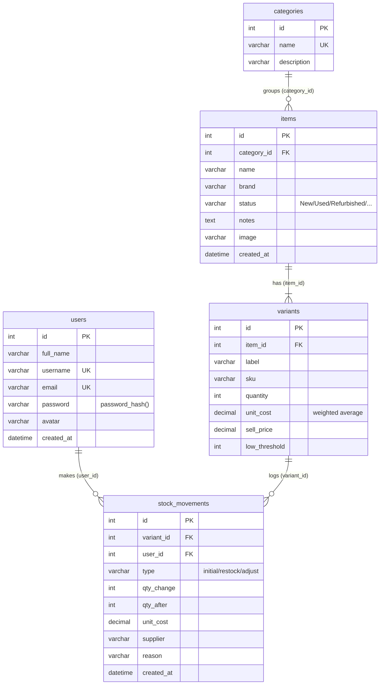

# 4. Database Reference

Database name: **`partsbin`** · Engine: **InnoDB** (supports foreign keys) · Charset: **utf8mb4**
Defined in `database.sql`, created automatically on the first visit by `includes/db.php`.

---

## Tables and relationships



Plain-text version (for the printout):
```
users (1) ──────────────< stock_movements (many)     user_id     ON DELETE SET NULL
categories (1) ─────────< items (many)               category_id ON DELETE SET NULL
items (1) ──────────────< variants (many)            item_id     ON DELETE CASCADE
variants (1) ───────────< stock_movements (many)     variant_id  ON DELETE CASCADE
```

| Table | Purpose | Notes |
|---|---|---|
| `users` | Accounts that can log in | `username` and `email` are `UNIQUE`. `password` holds a bcrypt hash (`VARCHAR(255)`) |
| `categories` | Groups like Processors or Memory | `name` is `UNIQUE` |
| `items` | A product (e.g. "Ryzen 7 9000 Series") | `image` = file name inside `uploads/products/` |
| `variants` | One version of a product (e.g. "9700X") | **Stock, cost and price live here**, not on the item |
| `stock_movements` | Audit log of every stock change | `qty_after` = stock after the change, so the history reads like a ledger |

### Foreign key actions: why each one
| FK | Action | Why |
|---|---|---|
| `items.category_id` | `SET NULL` | Deleting a category shouldn't delete products. They become "Uncategorized" |
| `variants.item_id` | `CASCADE` | A variant can't exist without its product |
| `stock_movements.variant_id` | `CASCADE` | History of a deleted variant has no meaning |
| `stock_movements.user_id` | `SET NULL` | Keep the history even if the account is removed (shows "system") |

### Why `DECIMAL(10,2)` for money?
`FLOAT` stores approximations (0.1 + 0.2 ≠ 0.3). `DECIMAL` stores exact pesos and centavos.

### Why are items and variants separate tables? (normalization)
One product has many versions. Putting `brand`, `category` and `image` on every variant would repeat data. Splitting them means the product details are stored once, and each variant row only holds what differs.

---

## Important queries, explained

### 1. Dashboard totals: one query, four numbers (`index.php:15-21`)
```sql
SELECT COUNT(*)                                AS variants,
       COALESCE(SUM(quantity), 0)              AS units,
       COALESCE(SUM(quantity * unit_cost), 0)  AS cost_value,
       COALESCE(SUM(quantity <= low_threshold), 0) AS low_count
FROM variants
```
`quantity <= low_threshold` is 1 (true) or 0 (false) in MySQL, so `SUM` of it **counts** the low variants.

### 2. Product list with totals per product (`items.php:43-61`)
```sql
SELECT i.*, c.name AS category,
       COUNT(v.id) AS variant_count,
       COALESCE(SUM(v.quantity), 0) AS total_qty,
       COALESCE(SUM(v.quantity <= 0), 0) AS out_count,
       COALESCE(SUM(v.quantity > 0 AND v.quantity <= v.low_threshold), 0) AS low_count,
       GROUP_CONCAT(v.label ORDER BY v.id SEPARATOR " · ") AS variant_labels
FROM items i
LEFT JOIN categories c ON c.id = i.category_id
LEFT JOIN variants v   ON v.item_id = i.id
WHERE (i.name LIKE ? OR i.brand LIKE ? OR EXISTS (
        SELECT 1 FROM variants sv WHERE sv.item_id = i.id AND (sv.label LIKE ? OR sv.sku LIKE ?)))
GROUP BY i.id, ...
HAVING low_count > 0                     -- only when "Low stock" filter is chosen
ORDER BY c.name IS NULL, c.name, i.name  -- uncategorized products last
```
- `LEFT JOIN`: products with no category or no variants still show
- `GROUP_CONCAT`: joins all variant labels into one text, e.g. `9700X · 9800X3D`
- `EXISTS`: a subquery that is true if **any** variant matches, without duplicating rows
- `HAVING`: filters on totals after grouping (WHERE can't see `low_count`)
- The WHERE conditions are only added when a filter is filled in (built in PHP with `$where[]` + `implode(' AND ', ...)`)

### 3. Low-stock list (`index.php:40-47`)
```sql
SELECT v.*, i.name AS item_name, i.image
FROM variants v JOIN items i ON i.id = v.item_id
WHERE v.quantity <= v.low_threshold
ORDER BY v.quantity, i.name
LIMIT 10
```

### 4. Stock history with names (`includes/functions.php:240-252`)
```sql
SELECT m.*, v.label, v.item_id, i.name AS item_name, u.username
FROM stock_movements m
JOIN variants v ON v.id = m.variant_id
JOIN items i    ON i.id = v.item_id
LEFT JOIN users u ON u.id = m.user_id      -- LEFT: user may be NULL ("system")
WHERE $where                               -- e.g. "m.variant_id = ?" or "m.type = 'restock' AND ..."
ORDER BY m.created_at DESC, m.id DESC
LIMIT $limit
```
One function reused by the Dashboard, Product page, Stock page, Restocks page and AI.

### 5. Restock: update stock + log it (`includes/functions.php:378-385`)
```sql
UPDATE variants SET quantity = ?, unit_cost = ? WHERE id = ?;               -- 'idi'
INSERT INTO stock_movements (variant_id, user_id, type, qty_change, qty_after,
                             unit_cost, supplier, reason, created_at)
VALUES (?, ?, ?, ?, ?, ?, ?, ?, ?);                                         -- 'iisiidsss'
```

### 6. Many variants in one statement (`includes/functions.php:326-328`)
```sql
INSERT INTO variants (item_id, label, sku, quantity, unit_cost, sell_price, low_threshold)
VALUES (?, ?, ?, 0, ?, ?, ?), (?, ?, ?, 0, ?, ?, ?), (?, ?, ?, 0, ?, ?, ?)
```

### 7. Valuation by category (`valuation.php:14-25`)
```sql
SELECT COALESCE(c.name, 'Uncategorized') AS category,
       COUNT(v.id) AS variants,
       SUM(v.quantity) AS units,
       SUM(v.quantity * v.unit_cost)  AS cost_value,
       SUM(v.quantity * v.sell_price) AS retail_value
FROM variants v
JOIN items i ON i.id = v.item_id
LEFT JOIN categories c ON c.id = i.category_id
GROUP BY COALESCE(c.name, 'Uncategorized')
ORDER BY cost_value DESC
```

### 8. Category list with counts (`categories.php:51-61`)
```sql
SELECT c.id, c.name, c.description,
       COUNT(DISTINCT i.id) AS items,      -- DISTINCT: joining variants repeats each item
       COALESCE(SUM(v.quantity), 0) AS units,
       COALESCE(SUM(v.quantity * v.unit_cost), 0) AS value
FROM categories c
LEFT JOIN items i    ON i.category_id = c.id
LEFT JOIN variants v ON v.item_id = i.id
GROUP BY c.id, c.name, c.description
ORDER BY c.name
```

### 9. Uniqueness checks that exclude the current row
```sql
SELECT id FROM categories WHERE name = ? AND id <> ?     -- categories.php:22
SELECT id FROM users WHERE email = ? AND id <> ?         -- profile.php:26
```
`<>` means "not equal". Your own current name or email doesn't count as a duplicate.

### 10. Login lookup (`login.php:27`)
```sql
SELECT * FROM users WHERE username = ? OR email = ?
```

---

## Live in phpMyAdmin (if the panel wants to see the data)

Open `http://localhost/phpmyadmin` → `partsbin` → **SQL** tab:
```sql
-- show that passwords are hashed
SELECT id, username, password FROM users;

-- show the audit trail of the variant restocked in the demo
SELECT m.created_at, m.type, m.qty_change, m.qty_after, m.unit_cost, m.supplier, m.reason
FROM stock_movements m JOIN variants v ON v.id = m.variant_id
WHERE v.sku = 'CPU-INT-U5-225' ORDER BY m.id;

-- show the foreign keys
SHOW CREATE TABLE variants;
```
